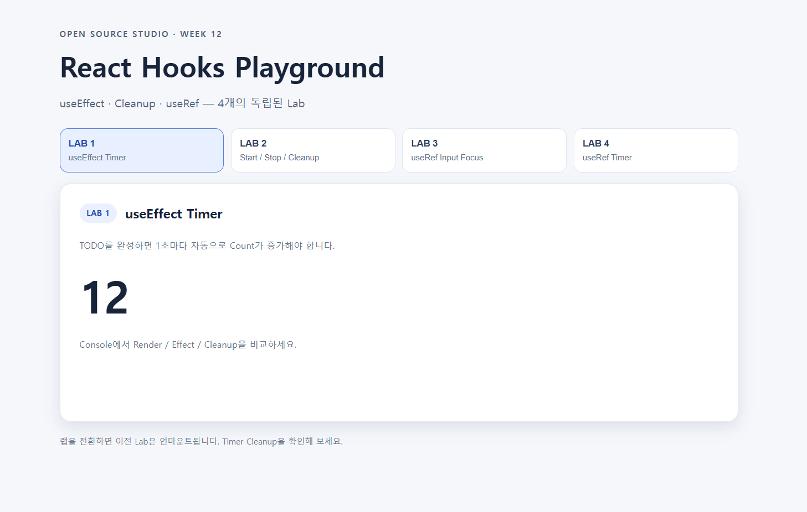

# Assign 12 / 박은별 22300308

## Project Information: 프로젝트 소개 및 Starter Project 정보
- React Hooks 학습을 위한 스타터 프로젝트
- 4개의 Lab component에 To Do 부분을 작성하도록 되어있음


## Installation: 설치·실행 방법 및 실행 화면
- Node.js 20.19+ 또는 22.12+ 권장. 프로젝트 폴더에서 실행:

```bash
npm install
npm run dev
```
-  


## Source Code Exploration: 주요 파일 구조, useEffect 및 useRef 분석, 주요 코드 2개 설명
1. Project Structure: App.jsx와 주요 Lab 컴포넌트의 역할
- App.jsx: Lab을 전환해도 달라지지 않는 부분의 레이아웃과 Lab이 전환되도록 함.
- Lab 컴포넌트: 각각의 react기능을 실습하도록 4개로 나뉘어져 있음.
2. useEffect: Effect, Dependency Array 및 Cleanup의 동작 원리
- useEffect에서 Effect파트는 실행할 작업을 작성하고, Deepndency는 실행시점 즉 Effect를 실행하는 조건이며 Cleanup은 앞선 실행을 정리하는 역할을 함.
3. useRef: .current 속성과 useState의 차이
- .current와 달리 useState는 setState함수를 통해 값을 변경하고 UI를 매번 새로 렌더링 한다.
4. Code Analysis: useEffect와 useRef 관련 주요 코드 각 1개(5~15줄)를 선택하여 동작 원리 설명
- ./src/components/Lab1_EffectTimer.jsx:8-18 : setCount와 setInterval을 사용하여 1초마다 count의 값이 1씩 증가하도록 하고 그 값을 id에 저장. 재실행하게될 경우 clearInterval을 통해 id값을 초기화.
- ./src/components/Lab3_InputFocus.jsx:6-17 : inputRef를 생성하고, focusInput과 clearInput함수에서 inputRef.current로 접근하여 값을 활용 및 수정한다.

## Lab Implementation: 4개 Lab 구현 내용 및 실행 결과
1. useEffect를 활용하여 Lab을 실행하면 1초마다 자동으로 화면의 숫자가 증가하도록 함.
2. start버튼을 누르면 숫자가 증가, stop버튼은 증가를 멈추도록 하고, reset버튼은 타이머를 멈추고 숫자를 0으로 초기화시킴. 
3. useRef를 사용하여 focus버튼을 누르면 이름 작성란이 선택되고, clear를 누르면 작성해둔 내용이 지워지며 다시 커서가 선택된 상태가 된다. 
4. Lab2와 같은 기능을 useRef를 활용하여 구현.

## Lab Comparison: STEP 3의 비교 분석 질문 4개에 대한 답변
1. useEffect의 Dependency Array가 필요한 이유는? 
- 타이머가 버튼과 상관없이 초기화되는것을 막고 1초마다 증가할수 있도록 함.
2. Cleanup을 사용하지 않으면 어떤 문제가 발생할 수 있는가?
- 이전 타이머를 삭제하지 않으면 값이 겹칠 수 있음
3. useState와 useRef의 가장 중요한 차이는?
- 값변경시 렌더링 여부가 달라서 사용목적이 다름.
4. LAB 2와 LAB 2의 Timer 관리 방식은 어떻게 다른가?
- LAB 2는 useEffect를 활용하여 화면의 표시되는 상태만 바꾸었고 LAB 4는 useRef를 이용하여 내부에 값이 저장됨.

## Customizing: 수정 내용 및 파일명

## Deployment: 실제 접근 가능한 Vercel URL
[Vercel URL](https://week12-starter-project-flax.vercel.app/)

## Weekly Review:
1. 새롭게 배운 내용 3가지
2. 어려웠던 점과 해결 방법
3. AI 활용 내용 및 느낀 점